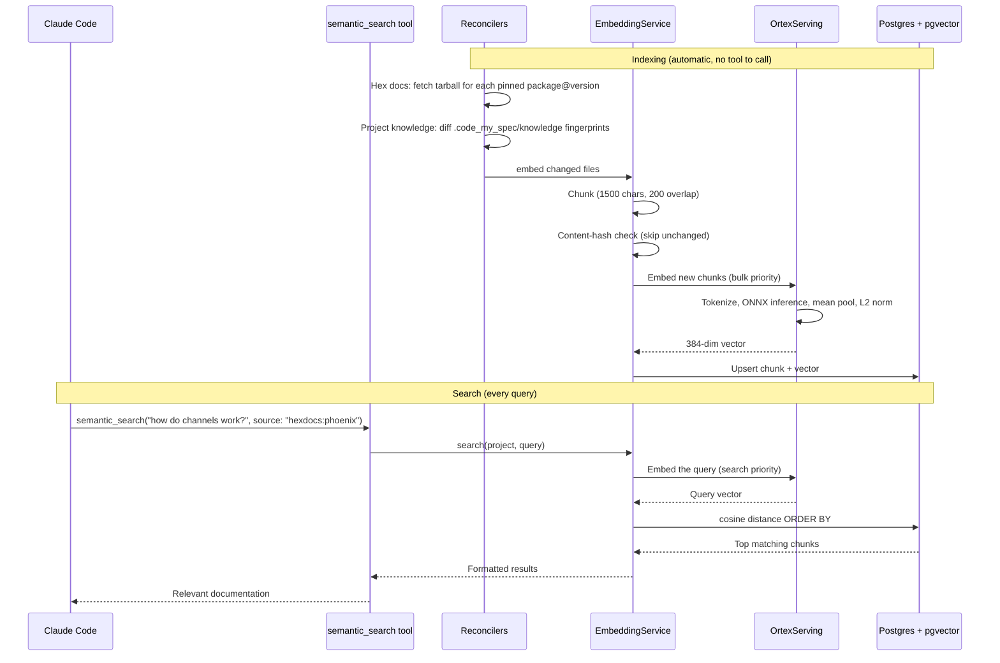

---
# Metadata for elixir_embedding_pipeline.md

# Required fields
slug: elixir-embedding-pipeline
type: blog
title: "How I Built a Local Embedding Pipeline in Elixir That Searches My Own Docs"

# Publishing control
protected: false
publish_at: "2026-04-10T00:00:00Z"
expires_at: null

# SEO Metadata
meta_title: "Local Embedding Pipeline in Elixir with Ortex"
meta_description: "Parse hex docs into markdown, embed them with Ortex and all-MiniLM, search with pgvector, serve it through one MCP tool. No embedding API calls."
og_title: "How I Built a Local Embedding Pipeline in Elixir"
og_description: "Parse hex docs, embed with Ortex, search with pgvector, serve through MCP to Claude Code. The model ships inside the app."
og_image: null

metadata:
  template: article
  author: John Davenport
  category: AI Development
  featured: false

tags:
  - elixir
  - embeddings
  - ortex
  - pgvector
  - mcp
  - beam
  - semantic-search
  - claude-code
---

# How I Built a Local Embedding Pipeline in Elixir That Searches My Own Docs

I wanted my Elixir harness to search HexDocs for all my current dependency versions and my project documentation without calling an external embeddings API. No OpenAI embeddings endpoint. No Ollama sidecar. The model ships inside the app.

I got inspired by the [HexDocs MCP server](https://hexdocs.pm/hexdocs_mcp/readme.html). They had a cool approach, but they were scraping HexDocs instead of using the versions my project actually pins, and they were embedding with Ollama through a Node MCP server. I wanted it all contained inside my own Elixir stack. That constraint shaped every decision.

This pipeline has been rebuilt once since I first wrote about it. The first version ran entirely inside the desktop app with SQLite. It now embeds on the server and stores vectors in Postgres. This post describes how it works today, and where the first version differed.

## The Architecture



### 1. Pulling markdown out of hex packages

Elixir docs are already markdown. The first version read them out of compiled bytecode with `:beam_lib.chunks/2`, straight from the `.beam` files in `_build/`:

```elixir
defp extract_beam(path) do
  with {:ok, binary} <- File.read(path),
       {:ok, {mod, [{~c"Docs", docs_bin}]}} <- :beam_lib.chunks(binary, [~c"Docs"]),
       {:docs_v1, _anno, _lang, format, mod_doc, _meta, func_docs} <-
         :erlang.binary_to_term(docs_bin) do
    if format == "text/markdown" do
      [%{module: mod, markdown: render_module(mod, mod_doc, func_docs)}]
    else
      []
    end
  else
    _ -> []
  end
end
```

That worked, and I was proud of it, until the pipeline moved to the server. The server never compiles your project, so there's no `_build/` to walk. And reading doc chunks ties extraction to the OTP version that compiled them, with an unrecognised chunk raising.

So the current extractor works from source. A reconciler reads the versions your project's `mix.lock` pins, fetches each package's tarball from hex.pm, verifies it against the lock's checksum, and parses the `@moduledoc` and `@doc` literals out of `lib/**/*.ex` with `Code.string_to_quoted/1`. Source docs are plain markdown, and that parse is independent of the OTP version. Each `package@version` gets embedded once, no matter how many projects depend on it.

### 2. Serving: local embeddings with Ortex

My first attempt was with Bumblebee and Nx. That failed because I couldn't get it wrapped into Burrito (the tool I use to package the desktop app). Ortex worked because it's plain ONNX Runtime with a clean NIF, no complex build dependencies.

```elixir
defmodule CodeMySpec.Embeddings.OrtexServing do
  use GenServer

  @model_name "all-MiniLM-L6-v2"
  @model_path "priv/models/#{@model_name}.onnx"
  @tokenizer_path "priv/models/#{@model_name}.tokenizer.json"
  @max_length 256
```

It's a GenServer that loads all-MiniLM-L6-v2 through Ortex. Both the ONNX model and the tokenizer ship with the app in `priv/models/`, and nothing is fetched at runtime, so it works offline.

The inference pipeline: tokenize with the HuggingFace tokenizer, truncate and pad to uniform length, build Nx tensors (ONNX BERT expects int64), run through Ortex, mean pool the hidden states with the attention mask, L2 normalize. Out come 384-dimensional embeddings.

One model, one queue, two priorities. A search embeds a single query, while the reconcilers embed whole packages' worth of chunks. If those shared a plain FIFO mailbox, a search could wait behind a package. So every call carries a priority, `:search` or `:bulk`, and the next job always comes off the search queue first.

I picked all-MiniLM-L6-v2 because it's about 80MB, fast, and good enough for doc search. No need for a giant model when you're matching "how do I create a Phoenix channel" against API docs.

### 3. EmbeddingService: chunk, deduplicate, store

It takes a document, chunks it (1500 characters, 200 overlap), embeds the chunks, and stores them with their vectors.

Content-hash deduplication: a file whose hash hasn't changed skips re-embedding entirely. Re-indexing a knowledge base after editing one file takes seconds because only changed files get re-embedded.

```elixir
defp content_hash(text) do
  :crypto.hash(:sha256, text) |> Base.encode16(case: :lower)
end
```

Each row is stamped with the model that produced it, so swapping the model becomes a re-embed instead of silently mixing vector spaces.

Storage is a `Backend` behaviour. The server uses Postgres with the pgvector extension and an HNSW index built with `vector_cosine_ops`, and search is cosine distance (`<=>`). The first version used SQLite with the sqlite_vec extension inside the desktop app. I moved to pgvector when embedding became a server job, because many projects share the same hex package embeddings and Postgres already holds everything else.

### 4. One MCP tool: semantic_search

A single MCP tool exposes the search to Claude Code, with a `source` filter:

- `knowledge` is the framework reference (LiveView, DaisyUI, and so on).
- `project_knowledge` is your project's own research and decisions from `.code_my_spec/knowledge`.
- `hexdocs` searches every embedded hex package, and `hexdocs:<package>` narrows to one, like `hexdocs:phoenix`.

Claude asks "how does Phoenix.Channel handle joins" and gets the actual current API docs for the version I'm running, not hallucinated ones from training data. Leave the filter off and it searches everything.

There's no sync tool and nothing to trigger. Hex docs appear once the server has embedded the versions your lockfile pins. Project knowledge appears once the harness reports a change under `.code_my_spec/knowledge`.

## The Stack

| Component | Library | Purpose |
|-----------|---------|---------|
| Doc extraction | Code.string_to_quoted | Moduledocs and docs from hex package source |
| Model inference | Ortex (ONNX Runtime) | Run all-MiniLM-L6-v2 locally |
| Tokenization | Tokenizers (HuggingFace) | BERT tokenization |
| Tensor math | Nx | Mean pooling, L2 normalization |
| Vector storage | pgvector | Cosine distance search, HNSW index |
| Database | Postgres via Ecto | Chunk storage, deduplication |
| MCP server | Anubis | Tool interface for Claude Code |

Everything runs in the same BEAM VM. No sidecar services. No hosted embeddings API, no API keys for embedding.

{{enforced_boundary_cta shape="aside" headline="The whole pipeline runs inside one BEAM VM with no sidecars and no embeddings API." sub="Building a component like this is the easy half; keeping it aligned with its spec over time is not." body="CodeMySpec specifies each Phoenix component up front and gates the work when the code stops matching the spec." label="Walk the component workflow" campaign="elixir-embedding-pipeline"}}

## What I'd Do Differently

The chunking is naive, character count with overlap on line boundaries. I'd rather chunk on markdown headers so each chunk is a semantically complete section. Right now a function doc can split across two chunks.

No reranking yet. Cosine distance is good enough for doc search, but a cross-encoder reranker would help for nuanced queries.

The first version made me trigger embedding by hand through an MCP tool. That's gone: reconcilers now keep the index current on their own.

## Related Articles

- [EarWitness: A Local-First Build by the Harness](/case-studies/ear-witness)
- [Why Phoenix Contexts Are Perfect for LLM-Based Code Generation](/blog/why-phoenix-contexts-are-great-for-llms)
- [How to Prevent Slop in AI-Generated Elixir Codebases](/blog/prevent-slop-elixir-codebases)
- [My first serious coding workflow with AI](/blog/my-first-serious-coding-workflow)
- [How CodeMySpec Built and Verified a Fuel Card App in 5 Days](/blog/fuellytics-bdd-and-qa)
