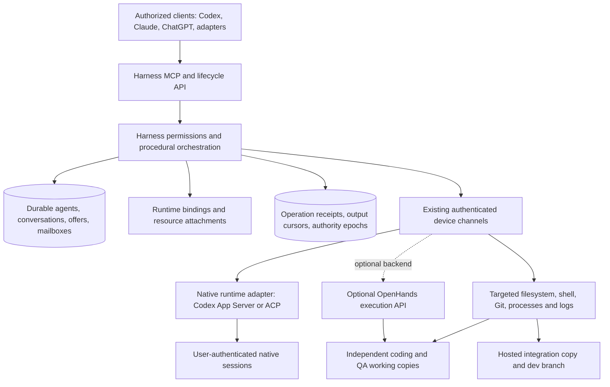

# Recommendation: keep the harness, separate runtime bindings from resource attachments

**Yes—with a hybrid integration.** Main and product can have durable identities independent of working copies and runtimes while the harness grants access to authorized development environments. Existing open-source infrastructure can supply native-session adapters and optional remote execution APIs. Neither primary candidate replaces the need for explicit authority, operation recovery and workspace-version checks.

The smallest viable integration is to keep the existing server/database, device channel, offers, mailbox and promotion logic; add explicit runtime placement and target-aware tools; then connect one native Codex runtime through its supported App Server interface or a narrowly scoped ACP adapter. Do not introduce a second task framework.

## Preferred architecture

This is a proposed design, not an implemented deployment. Main's reasoning may run in any authorized client or a harness-managed runtime. It does not need a repository mount. When it calls a tool, the request explicitly selects a resource; provider-native local shell access must not silently stand in for that resource selection. Coding/QA may retain local native tools inside their assigned isolated environments.

## What to reuse

* **Our harness:** agent UUIDs and conversations, database mailbox consumption/generations, offer semantics/metrics, role grants, device registration/channel, working-copy UUIDs, team isolation and commit-aware promotion. The [architecture assessment](architecture-findings.md) identifies current seams and coupling points.
* **Provider-native interfaces:** Codex App Server is the first prototype choice because the installed binary successfully answered initialize and avoids an additional ACP package. That probe did not create a session or establish native resume. Evaluate against Harness Remote's ACP path with a real session before committing. Keep native login on the runtime host.
* **Harness Remote:** use its provider capability contract and `AcpClient`/`AcpService` claim, replay and steering behavior as concrete implementation references; optionally use a pinned sidecar for an early native-session experiment. Its targeted tests passed, but actual provider adapters were not executed here. Avoid treating internal JS classes as stable public APIs. License is Apache-2.0.
* **OpenHands:** optionally use Agent Server REST file/Bash/Git APIs through `RemoteWorkspace`, without adopting `Conversation`. This can save container/backend work if those environments are already present. It is not necessary for the initial prototype on existing harness-connected devices. SDK/Agent Server is MIT at the inspected commit.

Source links, symbols, maturity and provider-specific limitations are in [candidate-comparison.md](candidate-comparison.md).

## What to build

1. **RuntimeBinding:** agent ID, runtime/provider kind, native session ID, runtime host ID, process/boot generation, capability set and lifecycle status. Agent identity survives binding replacement. Store whether a restart resumed native state or created a fresh session.
2. **ResourceAttachment:** agent ID, working-copy/environment UUID, target host ID, grant, attachment generation and last observed revision. Multiple attachments are allowed; team assignment remains its existing separate concept. A path is target-host metadata, not a globally trusted identity.
3. **ExecutionOperation:** client operation ID, request digest, caller/grant, target generation, writer epoch, state, result, output sequence and uncertainty/reconciliation information. Keep it separate from offers. Link an operation to an offer/message when relevant, without declaring the offer accepted merely because a command was admitted.
4. **Remote direct tools:** list/inspect targets; read/search/write/apply patch; start/status/cancel command; stream/replay output; inspect Git, processes and logs. A model prompt sent to a remote coding agent is not a substitute for direct execution.
5. **Authority and freshness checks:** target grants, single-writer native-session lease with fencing, observed file hashes/HEAD checks for edits, and current promotion checks. Host registry is live presence; database records are durable authority.

This is a small set of explicit seams, not a generalized distributed scheduler. The database ledger and per-resource fencing are where the integration is more than protocol translation.

## Required harness interfaces

Illustrative contracts, not final wire schemas:

| Interface | Required behavior |
|---|---|
| `environments.list/inspect` | Account/project-filtered IDs, host generation, capabilities, root metadata, live Git HEAD and dirty state |
| `attachments.attach/detach` | Authorized resource grant independent of the agent's runtime placement; preserve agent/conversation identity |
| `sessions.start/resume/observe/send/interrupt/stop` | Explicit runtime binding and provider capability checks; distinguish observer from writer and native resume from fresh start |
| `operations.submit` | Caller-supplied operation ID + request digest; durable admission; return receipt before waiting; same ID/different payload conflicts |
| `operations.get/cancel` | Unknown is a first-class outcome; cancel requests are not evidence of termination until confirmed |
| `operations.events(after)` | Ordered replay from a durable cursor; identify truncated/expired output explicitly |
| `files.read/search/apply` | Target-relative paths, target-side authorization and symlink policy; edits can require expected file hash |
| `git.inspect` / existing promotion | Observe live revision; retain existing certify/promote semantics and locks |
| `authority.acquire/renew/revoke` | Single writer per native session; monotonic fencing epoch checked at the execution boundary |

MCP can expose these methods to reasoning clients. Existing device channels or authenticated HTTP/WebSocket streams can carry execution and output underneath. MCP session IDs must not become durable agent identities. No claim is made that every listed client supports every needed MCP feature or approval flow identically; test each adapter separately.

## Components to avoid

Do not adopt Harness Remote task/run/work-thread orchestration, worktree promotion, auto-allow permission defaults or its local JSON ledger as distributed authority. Do not adopt OpenHands Agent Canvas, automation stack or default conversation ownership solely to gain remote Bash. Do not depend on issue #4187 as an implemented feature: it was closed for inactivity and the inspected factory still ties conversation placement to workspace type.

Do not transmit copied subscription refresh/access tokens in a new launch request. The current harness already has a credential-field distribution path; the prototype should not reuse that path. Native sessions must authenticate through provider-supported local flows. Hosted native Claude and own-product SDK usage have different documented conditions; resolve those at the deployment boundary rather than assuming adapter source code grants permission.

## Minimal next proof of concept

This is proposed follow-up implementation, not code delivered in this research.

* Use a disposable project with two independent copies on **two actual hosts**. Keep main/product identity and history in a control-plane database independent of both targets. Start the controller in an empty directory with no repository mount.
* Implement one target-addressed read/search/patch/command path over the existing device channel and one native Codex binding. Use a fresh research native session; never attach a live production session for failure testing.
* Read the same fixture on each host, patch one with an expected hash, run a test, inspect logs/Git and observe the integration revision. Switch attachment without replacing the logical agent.
* Start a long command with a marker operation ID; disconnect the controller, reconnect, recover output, and retry the ID. Verify one marker effect. Repeat with lost start acknowledgement and require explicit unknown/reconciliation if completion cannot be proved.
* Add a second observer and conflicting writer. Verify observation works and stale writers fail. Kill only the research runtime; distinguish native resume from new-session recovery. Replace the workspace; agent identity and central history must survive, with stale-context invalidation.
* Assert existing offer/metric transitions and promotion gates remain unchanged. Then test Claude separately after supported login and adapter review. Do not infer Claude behavior from Codex.

The important success criterion is preserved investigative capability from a repository-free main agent, not merely successful remote prompting.

## Proposed implementation sequence

1. Review these findings and agree the stable identity, runtime-binding and attachment semantics. No production refactor is included in this research.
2. Prototype the explicit target path against existing device channels; use direct Codex App Server first and compare a pinned ACP adapter only where it reduces code.
3. Validate the full two-host failure matrix and provider-supported authentication. Keep all experimental work isolated.
4. Add operation durability and leases before enabling state-changing remote tools broadly. Retain current mailbox and promotion authority.
5. Separate detached main/product lifecycle from copy supervision and replace relocation with attachment changes, using staged compatibility adapters for existing callers.
6. Add Claude and further client adapters after provider-specific continuation/concurrency tests. Add OpenHands execution backend only if measured integration savings justify the extra service.

## Open questions and decision limits

* Which deployment owns durable state if the desktop host is lost? Current database persistence is not automatically replicated control-plane durability.
* Can installed supported Codex/Claude versions preserve the exact native session across the planned restart/disconnect paths? Only Codex initialize was exercised live; 59 candidate tests used fakes.
* Which native tool restrictions let main use harness-mediated remote resources without accidentally executing in its own runtime directory?
* Do we need provider-native state portability across runtime hosts, or is durable logical identity plus explicit new native binding acceptable? The latter is feasible with the current direction; transparent arbitrary native-state migration is not established.
* How should concurrent human input arbitrate with main's interventions? Prefer one leased writer and explicit handoff, with many observers.
* What output retention and operation deduplication window are required? Harness Remote's bounded local ledger is insufficient as an unqualified guarantee.
* Which environment backends require container-level isolation beyond independent Git worktrees?
* What plan/workspace concurrency, billing and hosting terms apply to the exact user-owned runtimes? No numeric universal concurrency limit was verified.

The evidence supports **location-independent logical agents and harness-mediated multiplicity**, with selective reuse. It does not support promising concurrent native writers, automatic session migration across arbitrary hosts, or exactly-once shell execution under every failure. The smallest practical path keeps those distinctions explicit.
